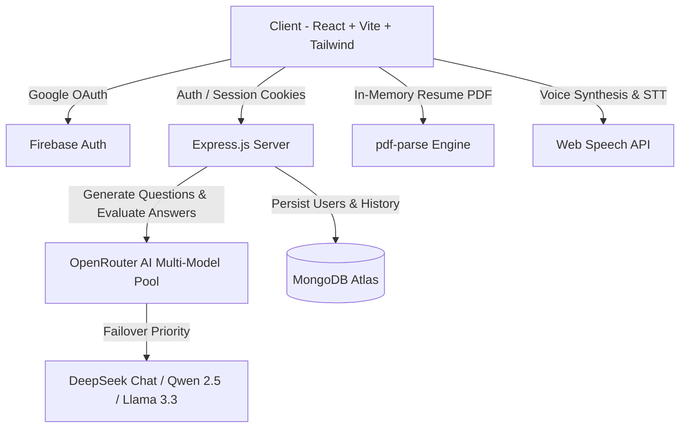

# 🤖 InterviewIQ.AI — AI-Powered Smart Mock Interview Platform

[](https://react.dev/)
[](https://tailwindcss.com/)
[](https://nodejs.org/)
[](https://www.mongodb.com/)
[](https://openrouter.ai/)
[](https://firebase.google.com/)

> **InterviewIQ.AI** is an advanced AI interview simulation platform designed to help engineers, students, and professionals prepare for technical and behavioral interviews. It combines real-time voice synthesis, live speech recognition, dynamic AI question generation, and strict neural report evaluation.

---

## 🌟 Key Features

### 1. 🎯 Dynamic AI Question Generation
- **Never the same interview**: Questions are dynamically created in real-time by LLMs based on target **Job Role**, **Experience Level** (*Junior / Entry*, *Mid Level*, *Senior*, *Lead*), and **Interview Mode** (*Technical*, *Behavioral*, or *Mixed*).
- **Resume-Tailored Tracks**: Upload your resume PDF for instant in-memory parsing (`pdf-parse`). The AI automatically detects your tech stack and personal projects to weave customized questions into your session.

### 2. 🎙️ Live Voice Interaction & Multi-Persona Simulation
- **Gender-Matched AI Voices**: Choose between **Sarah** (Female Persona) and **Alex** (Male Persona). The system utilizes browser speech synthesis voice enumeration to pair genuine female/male voices.
- **Voice-to-Text Speech Recognition**: Speak your answers naturally via the microphone with real-time continuous transcript preview, or edit your answers in the text editor.
- **Question Timers & Hints**: Realistic countdown timer and contextual hint cards.

### 3. 🧠 Grounded AI Performance Evaluation
- **Strict, Non-Random Scoring**: Evaluates candidate answers rigorously against core concepts, terminology, architectural tradeoffs, and STAR structure.
- **Strict 0% on Blank Answers**: If questions are unattempted or skipped, scores strictly reflect **0%** without artificial minimums.
- **In-Depth Breakdown**:
  - **Overall Performance Score** (0–100) and Letter Grade (A+, A, B, C, D).
  - **3 Core Sub-Metrics**: Technical Depth %, Communication Clarity %, Confidence & Tone %.
  - **Actionable Strengths & Opportunities**: Bullet points directly derived from your actual words.
  - **Question-by-Question Deep Dive**: Candidate transcript, detailed AI feedback, key points hit/missed, and model concepts.

### 4. 💳 Direct UPI Credit System
- Transparent pay-as-you-go credit model: Each full simulation session costs **50 credits**.
- Integrated **UPI Payment Modal** with dynamic QR code generation, merchant VPA copy, UTR transaction reference input, and instant verification top-ups.

### 5. 📊 Interview History & Archive Hub
- Complete historical record of every mock interview session.
- **Personal Analytics Dashboard**: Total sessions, average score %, peak score %, and total practice time.
- Search and filter by role with smooth scrollable tags and multi-criteria sorting (*Newest First*, *Oldest First*, *Highest Score*, *Lowest Score*).
- **Interactive Full Report Modal** and one-click **Print / Save as PDF** report export.

---

## 🏗️ System Architecture



---

## 📂 Repository Structure

```
AI_INTERVIEW/
├── client/                     # Frontend Application
│   ├── src/
│   │   ├── assets/             # Images, AI avatars, videos
│   │   ├── components/
│   │   │   ├── Navbar.jsx              # Navigation & user balance menu
│   │   │   ├── Step1Setup.jsx          # Role setup, resume upload & credit deduction
│   │   │   ├── Step2Interview.jsx      # Live interview lab, video avatars, voice STT/TTS
│   │   │   ├── Step3Report.jsx         # Performance analytics scorecard & deep dive
│   │   │   ├── UpiPaymentModal.jsx     # Direct UPI payment gateway modal
│   │   │   └── AuthModel.jsx           # Google & Email sign-in modal
│   │   ├── pages/
│   │   │   ├── Home.jsx                # Landing page
│   │   │   ├── InterviewPage.jsx       # 3-step interview coordinator
│   │   │   ├── HistoryPage.jsx         # Past interviews archive & report viewer
│   │   │   └── Auth.jsx                # Auth handler
│   │   ├── redux/                      # Redux Toolkit state slices (user, credits)
│   │   ├── utils/                      # Question bank fallback, Firebase config
│   │   ├── App.jsx                     # Route registry
│   │   └── main.jsx                    # Root entrypoint
│   └── package.json
│
├── server/                     # Backend API Server
│   ├── config/                 # DB connection (connectDB.js), JWT token generator
│   ├── controllers/
│   │   ├── auth.controller.js          # Google & standard auth
│   │   ├── user.controller.js          # Credit balances, in-memory resume parser
│   │   └── interview.controller.js     # Question generator, AI evaluator, history CRUD
│   ├── middleware/
│   │   └── isAuth.js                   # JWT cookie verification middleware
│   ├── models/
│   │   ├── user.model.js               # User schema (credits, name, email)
│   │   └── interview.model.js          # Interview report schema (scores, reviews)
│   ├── routes/
│   │   ├── auth.route.js
│   │   ├── user.route.js
│   │   └── interview.route.js
│   ├── services/
│   │   └── openRouter.services.js      # OpenRouter API client with model failover
│   ├── index.js                        # Express server entrypoint
│   └── package.json
│
├── .gitignore                  # Git ignore rules (secrets, node_modules, dist)
└── README.md                   # Project documentation
```

---

## ⚙️ Environment Variables Setup

### 1. Backend (`server/.env`)
Create a `.env` file in the `server/` directory:

```env
PORT=8000
MONGO_URL=mongodb+srv://<username>:<password>@cluster0.mongodb.net/InterviewIQ
JWT_SECRETE="your_jwt_secret_key"
OPENROUTER_API_KEY=sk-or-v1-your_openrouter_api_key
```

### 2. Frontend (`client/.env`)
Create a `.env` file in the `client/` directory:

```env
VITE_FIREBASE_APIKEY="your_firebase_web_api_key"
```

---

## 🚀 Getting Started

### Prerequisites
- **Node.js** >= 18.x
- **npm** >= 9.x
- **MongoDB Atlas** database connection string
- **OpenRouter API Key** (supports `deepseek/deepseek-chat`, `qwen/qwen-2.5-72b-instruct`, `meta-llama/llama-3.3-70b-instruct`)

### Installation

1. **Clone the repository**:
   ```bash
   git clone https://github.com/<your-username>/AI_INTERVIEW.git
   cd AI_INTERVIEW
   ```

2. **Install Backend Dependencies**:
   ```bash
   cd server
   npm install
   ```

3. **Install Frontend Dependencies**:
   ```bash
   cd ../client
   npm install
   ```

---

## 🏃 Running the Application

### 1. Start Backend Server
```bash
cd server
npm run dev
```
*Backend runs on `http://localhost:8000` (Production deployed at: `https://ai-interview-dy3z.onrender.com`).*

### 2. Start Frontend Client
```bash
cd client
npm run dev
```
*Frontend runs on `http://localhost:5174` (or `http://localhost:5173`).*

---

## 📡 API Endpoints Overview

| Method | Endpoint | Description | Auth Required |
|---|---|---|---|
| `POST` | `/api/auth/google` | Sign in or register via Google credential | No |
| `GET` | `/api/auth/logout` | Clear authentication cookie | No |
| `GET` | `/api/user/current-user` | Fetch active user profile and credit balance | Yes |
| `POST` | `/api/user/deduct-credits` | Deduct 50 credits before starting interview | Yes |
| `POST` | `/api/user/add-credits` | Recharge credits (UPI verification) | Yes |
| `POST` | `/api/user/parse-resume` | Parse uploaded PDF resume in memory | Yes |
| `POST` | `/api/interview/generate-questions` | Generate dynamic role & resume AI questions | Yes |
| `POST` | `/api/interview/evaluate` | Evaluate candidate answers with OpenRouter AI | Yes |
| `POST` | `/api/interview/save` | Save completed interview session to MongoDB | Yes |
| `GET` | `/api/interview/history` | Get all past sessions & calculated statistics | Yes |
| `GET` | `/api/interview/:id` | Get single session report | Yes |
| `DELETE` | `/api/interview/:id` | Delete interview record from history | Yes |

---

## 🔒 Security Best Practices
- **No Disk Clutter for Resumes**: Resume PDFs are processed in memory using `multer.memoryStorage()` and passed directly to the parser without saving sensitive files to disk.
- **HTTP-Only Cookies**: Authentication tokens are stored in `httpOnly`, `sameSite: "lax"` cookies, protecting them against XSS token harvesting.
- **Credentials Protection**: All `.env` files and secrets are excluded from source control via `.gitignore`.

---

## 📄 License
This project is licensed under the [MIT License](LICENSE).
